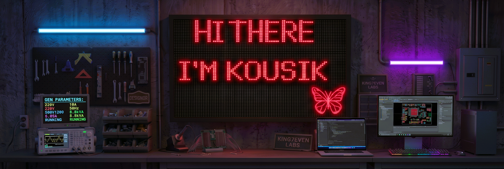
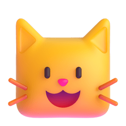
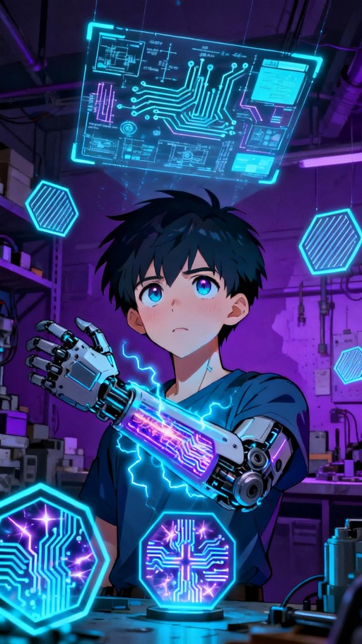
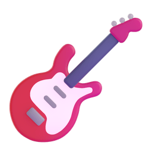
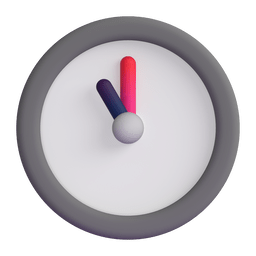
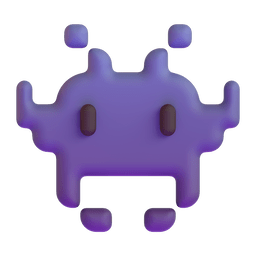

        

  

<h2 align="center">
   About me  
</h2>

<table>
  <tr>
    <td width="50%" valign="top">

- 🎓 **Education & Background:** Graduated in **Electronics and Communication Engineering (ECE)**, building a strong core in analog/digital electronics and system design.
- 💡 **Core Passion & Philosophy:** Deeply passionate about hardware design, custom PCB layouts, and embedded systems. I believe in transforming abstract circuit concepts into high-performance, physical reality—from custom breakout boards to multi-layer industrial hardware.
- 🛡️ **Hardware Reliability & Standards:** Focused on robust design practices including signal integrity, power integrity, ESD/EMI protection, and component-level optimization for industrial-grade reliability.
- 💻 **Technical Skillset:**
  - **PCB Design & EDA:** Multi-layer board layouts, schematic capture, stackup planning, and custom footprint libraries using **Altium Designer** and **KiCad**.
  - **Embedded Systems & IoT:** Firmware development and hardware-software integration across **C**, **Embedded C**, and communication protocols (**SPI, I2C, UART, Ethernet**).
  - **Programming & Networking:** Proficient in **Python**, **C**, and foundational networking configurations.
- 🎯 **Future Roadmap & Aspirations:** Actively upskilling and expanding expertise into **VLSI design** and **Edge AI**, with a long-term goal of stepping into chip-level integration and advanced silicon architecture.
    </td>
    <td width="50%" valign="top">
      

      
      

    </td>
  </tr>
</table>

<h2 align="center">
   Languages & Tech Stack 
</h2>

  
  
  
  
  
  

  
  
  

  
  
  
   

<h2 align="center">
   States and Activity 
</h2>

<table>
  <tr>
    <!-- Left Side: Streak Stats & Profile Stats -->
    <td width="50%" valign="top">
      
        
      
    </td>
    <!-- Right Side: Most Used Languages -->
    <td width="50%" valign="top">
      
    </td>
  </tr>
</table>

<h2 align="center">
   Connect with Me 
</h2>

  
  
  
   
  
   
  
   
  

 

<h2 align="center">
   Pacman eating my Contribution 
</h2>

  <picture>
    <source media="(prefers-color-scheme: dark)" srcset="https://raw.githubusercontent.com/KING7EVEN-LABS/KING7EVEN-LABS/output/pacman-contribution-graph-dark.svg">
    <source media="(prefers-color-scheme: light)" srcset="https://raw.githubusercontent.com/KING7EVEN-LABS/KING7EVEN-LABS/output/pacman-contribution-graph.svg">
    
  </picture>
  

    

