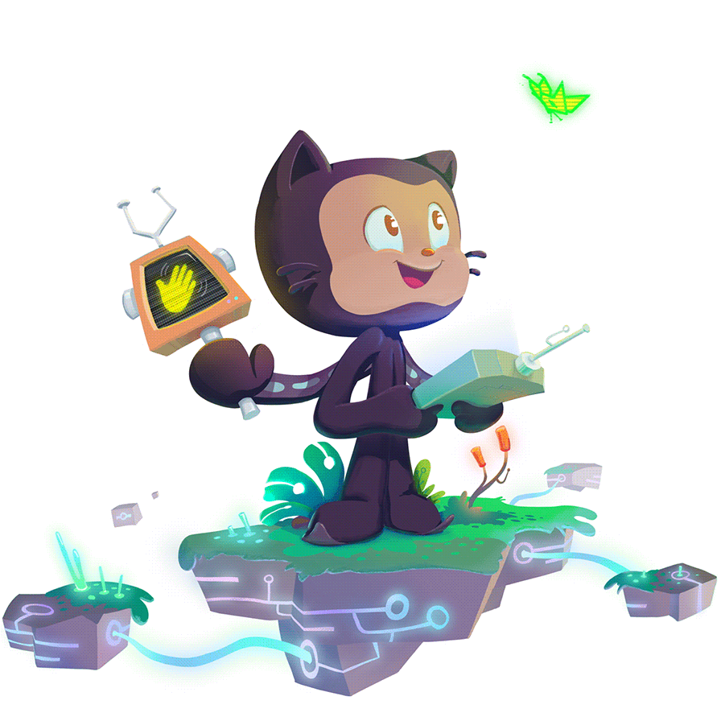

        

  

<h2 align="center">
   About me  
</h2>

<table>
  <tr>
    <td width="50%" valign="top">
<h3> I'm a passionate PCB Design Engineer dedicated to creating high-quality hardware and embedded systems.</h3>

* 🖥️ **Currently working on:** 4-Layer PCB Designs, Microcontroller Breakouts (ATmega2560, ESP32-S3)
* 🌱 **Actively learning:** Embedded IoT, VLSI Basics & Verilog
* 💬 **Ask me about:** Schematic Design, Custom Footprints, Altium Designer, KiCad, Layer Stackups
* 👥 **Open to collaborating on:** Open-source Hardware, PCB Layouts & Embedded Systems Projects
* ⚡ **Fun fact:** I love designing custom electronic hardware from scratch!
    </td>
    <td width="50%" valign="top">
      

      
      

    </td>
  </tr>
</table>
| Category | Technologies / Tools |
| :--- | :--- |
| **💻 Programming Languages** |        |
| **🛠️ Tools & Platforms** |     |
| **⚡ PCB Design & EDA** |  &nbsp;  |

<h2 align="center">
   States and Activity 
</h2>

<table>
  <tr>
    <!-- Left Side: Streak Stats & Profile Stats -->
    <td width="50%" valign="top">
      
        
      
    </td>
    <!-- Right Side: Most Used Languages -->
    <td width="50%" valign="top">
      
    </td>
  </tr>
</table>

<h2 align="center">
   Pacman eating my Contribution 
</h2>

  <picture>
    <source media="(prefers-color-scheme: dark)" srcset="https://raw.githubusercontent.com/KING7EVEN-LABS/KING7EVEN-LABS/output/pacman-contribution-graph-dark.svg">
    <source media="(prefers-color-scheme: light)" srcset="https://raw.githubusercontent.com/KING7EVEN-LABS/KING7EVEN-LABS/output/pacman-contribution-graph.svg">
    
  </picture>
  

    

